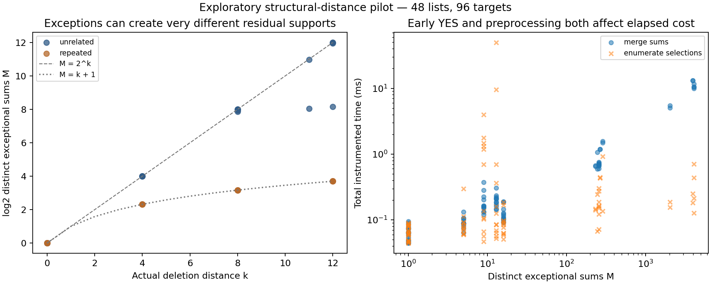

# Exploratory structural-distance pilot

**Status:** Development evidence for the first prototype. This is not the frozen prospective comparison.

The pilot used 48 lists and 96 list-target cases: 79 YES and 17 NO. All 444 completed solver answers agreed with the independent exact labels; all returned witnesses were checked against original indices.

Sizes are 16, 24, and 32; injected counts are 0, 4, 8, and 12; families have unrelated or repeated exceptions, with two lists per cell. Each list has a planted-subset target and an unfiltered uniform middle-range target, both labeled by an independent full half-enumeration oracle.

## Completion and total elapsed cost

Medians below include all attempted runs, including unresolved runs. The matched comparison includes only cases completed by both the method and MITM. One shuffled-order, instrumented Python run per case is descriptive timing evidence.

| Method | Completed / 96 | Median all attempts (ms) | Faster than MITM / matched cases |
|---|---:|---:|---:|
| bitset | 60 | 0.0280 | 55 / 60 |
| core_distinct | 96 | 0.1382 | 82 / 96 |
| core_enumerate | 96 | 0.0884 | 90 / 96 |
| dfs | 96 | 0.1093 | 94 / 96 |
| mitm | 96 | 7.1247 | 0 / 96 |

Unresolved outcomes and their reasons are retained in the raw data and summary. The bitset method is decision-only and has a separate 8-million-bit width cap; the other methods return indexed YES witnesses. Its times do not include witness storage.

## YES and NO workloads

Each median below uses only completed runs in the stated truth stratum; different completion sets need not be matched.

| Method | YES completed | YES median ms | NO completed | NO median ms |
|---|---:|---:|---:|---:|
| bitset | 52 | 0.1025 | 8 | 0.1425 |
| core_distinct | 79 | 0.1604 | 17 | 0.0737 |
| core_enumerate | 79 | 0.0909 | 17 | 0.0840 |
| dfs | 79 | 0.1101 | 17 | 0.0873 |
| mitm | 79 | 6.1764 | 17 | 8.4166 |

## Measured structural distance and residual support

Use one completed full support measurement per list. A root rejection or an interrupted support construction does not supply M.

| Exceptional family | Lists with M | Actual k range | M range | Median 2^k / M |
|---|---:|---:|---:|---:|
| unrelated | 24 | [0, 12] | [1, 4096] | 1.00 |
| repeated | 24 | [0, 12] | [1, 13] | 15.82 |

Repeated injected items duplicate a core value, so the detected exceptions create only k+1 sums. Unrelated exceptions can create nearly 2^k sums. A smaller support is a mechanism for reducing queries, but does not by itself establish a faster solver: generation has a cost, and selection enumeration can stop early on YES.

## Limits and next experiment

- No novelty claim or universal speedup follows from this pilot.
- Core discovery and verification are included in structural-solver elapsed time.
- State counters describe residual records and snapshots, not exact byte memory. Input/core storage and Python object overhead require separate profiling.
- Explicit work units count different primitive operations in different methods. Bitset operations process many bits and are not comparable to one scalar query step.
- Complete the literature audit, choose useful scales and budgets, profile bytes separately, and freeze a fresh comparison before interpreting practical advantages.
- Compare alternative cores next: minimum deletion count need not minimize residual support.

Configuration and source hashes are in [manifest.json](manifest.json). Inputs and oracle labels are in [cases.jsonl](cases.jsonl); measurements are in [runs.jsonl](runs.jsonl); aggregates are in [summary.json](summary.json).

