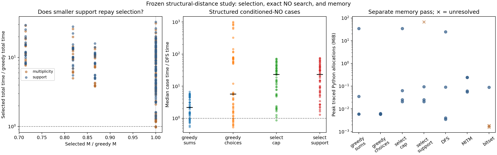

# Frozen structural-distance comparison

The protocol, generators, algorithms, reporting plan, and source snapshots were frozen locally before generating these evaluation weights or labels. This was not external preregistration.

The study contains **60 lists and 180 targets**, with 60 YES and 120 NO labels. All **3117 completed timing answers** agreed with independent exact labels. The separate memory pass checked 24 completed answers. All returned witnesses were valid.

## Scope and input conditioning

Sizes are 20, 28, and 36. Structured families use 4, 8, or 12 injected items; actual deletion distance is measured. There are also random 41-bit controls. Targets are planted-subset, unconditioned uniform middle-range, and middle-range conditioned on passing the stated modular checks and being NO.

Target counts: {'planted': 60, 'uniform_middle': 60, 'conditioned_no': 60}. Conditioned-NO counts by actual k: {3: 1, 4: 17, 7: 1, 8: 17, 11: 5, 12: 13, 18: 2, 26: 2, 34: 2}.

Generation outcomes: {'lists': 60, 'cases': 180, 'missing_no': 0, 'gcd_failures': 0, 'overlap_with_pilots': 0, 'within_study_overlap': 0}. Oracle preprocessing and proposal/query times are saved separately and excluded from solver timings. The conditioned-NO results concern that selected cohort; they are not unconditional average-case results.

## Does selecting a core reduce residual support?

Use one target-independent observation per list where both supports finished. An unavailable support is censored, not treated as small.

| Selector | Lists compared | Smaller M | Same M | Larger M | Median selected M / greedy M |
|---|---:|---:|---:|---:|---:|
| select_multiplicity | 56 | 18 | 38 | 0 | 1.000 |
| select_support | 54 | 18 | 36 | 0 | 1.000 |

The multiplicity selector minimizes a cheap cap in a local one-swap neighborhood. The support selector constructs up to four supports, charges every probe, and reuses the winning one. Neither finds a globally minimum-support core.

## Total time and completion

Each case time is the median of three independently shuffled-order runs. A case is completed only if every repetition completed. Paired comparisons use only cases completed by both methods. Ratios below 1 favor the row method. All selection and rejected-candidate costs are included.

| Method | Completed cases | Inconsistent repeats | Median completed ms | Wins / paired with DFS | Median ratio to DFS | Wins / paired with fastest baseline | Median ratio to fastest baseline |
|---|---:|---:|---:|---:|---:|---:|---:|
| core_distinct | 168 / 180 | 0 | 0.211 | 36 / 168 | 1.662 | 31 / 168 | 1.899 |
| core_enumerate | 168 / 180 | 0 | 1.276 | 48 / 168 | 2.335 | 41 / 168 | 3.103 |
| select_multiplicity | 168 / 180 | 0 | 2.651 | 4 / 168 | 17.189 | 0 / 168 | 19.279 |
| select_support | 162 / 180 | 0 | 2.528 | 0 / 162 | 19.266 | 0 / 162 | 20.239 |
| dfs | 168 / 180 | 0 | 0.116 | 0 / 168 | 1.000 | 0 / 168 | 1.000 |
| mitm | 180 / 180 | 0 | 24.382 | 14 / 168 | 54.942 | 0 / 180 | 44.572 |
| bitset | 25 / 180 | 0 | 1.331 | 4 / 25 | 25.922 | 0 / 25 | 25.922 |

The fastest baseline is the best of completed DFS, MITM, and bitset on each case. This is a casewise comparison and includes no selector. Bitset is decision-only, so its timings do not include witness storage. Median times in different rows may use different completion sets and are not directly matched speed ratios.

### Selectors versus the initial core

| Selector | Wins / paired | Median total-time ratio to greedy distinct sums |
|---|---:|---:|
| select_multiplicity | 5 / 168 | 9.034 |
| select_support | 0 / 162 | 9.211 |

### Strata against the fastest feasible baseline

| Cohort | Cases | Method | Wins / paired | Median time ratio |
|---|---:|---|---:|---:|
| structured_conditioned_no | 54 | core_distinct | 10 / 54 | 2.483 |
| structured_conditioned_no | 54 | core_enumerate | 9 / 54 | 5.701 |
| structured_conditioned_no | 54 | select_multiplicity | 0 / 54 | 23.168 |
| structured_conditioned_no | 54 | select_support | 0 / 54 | 25.528 |
| generic_conditioned_no | 6 | core_distinct | 0 / 2 | 305.239 |
| generic_conditioned_no | 6 | core_enumerate | 0 / 2 | 136.831 |
| generic_conditioned_no | 6 | select_multiplicity | 0 / 2 | 303.597 |
| generic_conditioned_no | 6 | select_support | 0 / 0 | — |
| unconditioned_uniform | 60 | core_distinct | 9 / 56 | 1.914 |
| unconditioned_uniform | 60 | core_enumerate | 7 / 56 | 6.757 |
| unconditioned_uniform | 60 | select_multiplicity | 0 / 56 | 19.279 |
| unconditioned_uniform | 60 | select_support | 0 / 54 | 18.485 |
| all_yes | 60 | core_distinct | 12 / 56 | 1.575 |
| all_yes | 60 | core_enumerate | 25 / 56 | 1.066 |
| all_yes | 60 | select_multiplicity | 0 / 56 | 18.036 |
| all_yes | 60 | select_support | 0 / 54 | 19.582 |
| all_no | 120 | core_distinct | 19 / 112 | 2.483 |
| all_no | 120 | core_enumerate | 16 / 112 | 6.436 |
| all_no | 120 | select_multiplicity | 0 / 112 | 20.110 |
| all_no | 120 | select_support | 0 / 108 | 21.104 |

## Cost components

Median phase milliseconds among each method's completed cases. Exact-support probe generation is inside selection; it is not counted a second time under generation. Root checks and other overhead appear in total time but not in these phase columns.

| Method | Discovery | Verification | Selection | Generation | Query |
|---|---:|---:|---:|---:|---:|
| core_distinct | 0.021 | 0.011 | 0.000 | 0.059 | 0.099 |
| core_enumerate | 0.021 | 0.011 | 0.000 | 0.000 | 1.212 |
| select_multiplicity | 0.021 | 0.011 | 1.911 | 0.060 | 0.096 |
| select_support | 0.021 | 0.011 | 2.383 | 0.000 | 0.092 |
| dfs | 0.000 | 0.000 | 0.000 | 0.000 | 0.075 |
| mitm | 0.000 | 0.000 | 0.000 | 21.104 | 2.324 |
| bitset | 0.000 | 0.000 | 0.000 | 0.000 | 1.316 |

## Unresolved outcomes

- core_distinct: {'time_limit': 36} (raw-run counts).
- core_enumerate: {'work_limit': 33, 'time_limit': 3} (raw-run counts).
- select_multiplicity: {'time_limit': 36} (raw-run counts).
- select_support: {'time_limit': 54} (raw-run counts).
- dfs: {'time_limit': 36} (raw-run counts).
- mitm: none (raw-run counts).
- bitset: {'bitset_limit': 465} (raw-run counts).

## Separate memory profiles

The predeclared subset has one conditioned-NO case per family at n=20 (r=8 for structured lists), seed replicate zero. Inputs already exist when tracing starts. Reported peaks are Python-traced allocations, not process RSS. Time caps are disabled in this pass; work/state/bitset caps are unchanged. Memory completion is therefore recorded separately.

| Family | Method | Status | Peak MiB |
|---|---|---|---:|
| unrelated | core_distinct | no (exhausted) | 0.0358 |
| unrelated | core_enumerate | no (exhausted) | 0.0062 |
| unrelated | select_multiplicity | no (exhausted) | 0.0641 |
| unrelated | select_support | no (exhausted) | 0.0937 |
| unrelated | dfs | no (exhausted) | 0.0910 |
| unrelated | mitm | no (exhausted) | 0.2418 |
| unrelated | bitset | unresolved (bitset_limit) | 0.0019 |
| repeated | core_distinct | no (exhausted) | 0.0060 |
| repeated | core_enumerate | no (exhausted) | 0.0060 |
| repeated | select_multiplicity | no (exhausted) | 0.0209 |
| repeated | select_support | no (exhausted) | 0.0209 |
| repeated | dfs | no (exhausted) | 0.0040 |
| repeated | mitm | no (exhausted) | 0.0616 |
| repeated | bitset | unresolved (bitset_limit) | 0.0018 |
| gadget | core_distinct | no (exhausted) | 0.0059 |
| gadget | core_enumerate | no (exhausted) | 0.0059 |
| gadget | select_multiplicity | no (exhausted) | 0.0254 |
| gadget | select_support | no (exhausted) | 0.0254 |
| gadget | dfs | no (exhausted) | 0.0035 |
| gadget | mitm | no (exhausted) | 0.0555 |
| gadget | bitset | no (decision_only) | 0.0895 |
| generic | core_distinct | no (exhausted) | 34.2876 |
| generic | core_enumerate | no (exhausted) | 0.0058 |
| generic | select_multiplicity | no (exhausted) | 34.2952 |
| generic | select_support | unresolved (work_limit) | 67.4941 |
| generic | dfs | no (exhausted) | 24.7675 |
| generic | mitm | no (exhausted) | 0.2432 |
| generic | bitset | unresolved (bitset_limit) | 0.0016 |

## Interpretation limits

- Support reductions and wall-clock gains are distinct. The time comparison includes discovering the alternative decomposition.
- Completion-based comparisons exclude censored runs; the excluded counts remain visible. They do not establish performance on those harder cases.
- This small synthetic study does not establish statistical significance, a universal speedup, a globally optimal decomposition, or algorithmic novelty.
- The [literature audit](../../LITERATURE.md) identifies established components and the stronger theoretical algorithms omitted from these elementary baselines.

## Reproducible artifacts

- [Frozen protocol](protocol.json) and [source snapshots](sources/).
- [Lists and generation accounting](lists.jsonl), [targets and labels](cases.jsonl), and [NO proposal log](proposals.jsonl).
- [Raw timing repetitions](runs.jsonl), [separate memory profiles](memory.jsonl), and [machine-readable summary](summary.json).

