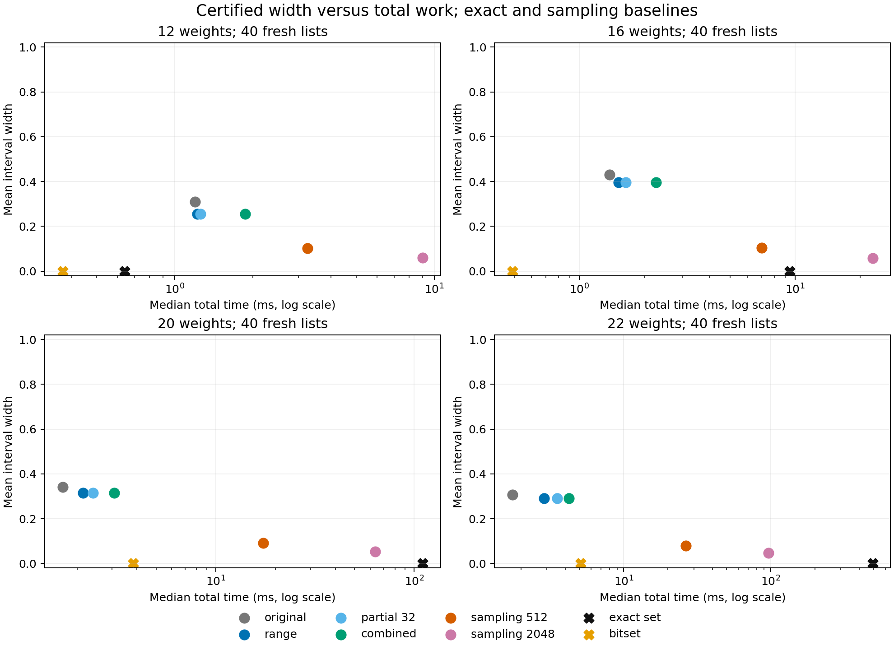

# Deterministic subset-sum refinement: evidence report

Completed October 23, 2026. This study implements steps 1–3 of the handoff. Its verified theory and measurements are now incorporated into the expanded [Paper III](../../notes/03-probability-valued-subset-sum/Probability_Valued_Subset_Sum.html). Publication integration did not change the frozen algorithms or evidence.

## What was established

- The original range-only result reproduced: **778/1,000** improved intervals, **13.10%** mean per-list narrowing, and **1,000/1,000** containment.
- A protocol and source hashes were frozen before generating **160** fresh lists: 20 per family at each of 12, 16, 20, and 22 weights. No sorted weight list overlaps any of the 2,940 original lists.
- Every tested deterministic method contained every fresh exact answer. Bitset labels independently agreed on **149/160** feasible cases; **11** exceeded the predeclared 100-million-bit cap after GCD compression.
- Partial collisions plus the residue cap narrowed **75/160** intervals further than range counting. The mean additional absolute width removed was **0.00012839**.
- Exact-decision sampling covered the truth simultaneously at all three reported budgets on **160/160** lists; its simultaneous nominal coverage is at least 95% per list.

The deterministic claim is proved algebraically in [THEOREM.md](THEOREM.md). Fresh containment is an implementation check, not the source of its universal validity. No new complexity or novelty claim follows from these experiments.

## Original cohort: reproduction and collision oracle

| Method | Contained truth | Mean per-list width removed | Mean width | Median incremental time (ms) |
|---|---:|---:|---:|---:|
| original | 1000/1000 | 0.00% | 0.404452 | 0.245 |
| range | 1000/1000 | 13.10% | 0.372927 | 0.398 |
| moment_cap | 1000/1000 | 13.10% | 0.372927 | 0.398 |
| partial_8 | 1000/1000 | 13.11% | 0.372887 | 0.503 |
| partial_32 | 1000/1000 | 13.11% | 0.372887 | 0.495 |
| residue_cap | 1000/1000 | 13.10% | 0.372922 | 1.040 |
| combined | 1000/1000 | 13.11% | 0.372855 | 1.146 |
| full_collision_oracle | 1000/1000 | 88.08% | 0.099492 | 6.231 |

The reproduced mean range width is 0.372926981391316, from 0.4044522237405377. Mean-width reduction is 7.79%; the 13.10% number averages the fractional reduction separately on each list. These are different statistics.

Regression timings reuse saved witnessed counts and exclude their original construction. The full-collision row uses the **exact target histogram and exact maximum representation count** as an evaluation oracle. Its time excludes half-set construction. A full histogram already reveals exact support; this row is diagnostic, not a proposed approximation algorithm.

## Fresh study: all preprocessing charged

| Method | Contained truth | Mean per-list width removed | Mean width | Median total time (ms) | Mean total time (ms) |
|---|---:|---:|---:|---:|---:|
| original | 160/160 | 0.00% | 0.346567 | 1.610 | 1.551 |
| range | 160/160 | 14.15% | 0.314830 | 1.901 | 1.981 |
| moment_cap | 160/160 | 14.18% | 0.314734 | 1.910 | 1.993 |
| partial_8 | 160/160 | 14.18% | 0.314723 | 1.983 | 2.243 |
| partial_32 | 160/160 | 14.18% | 0.314723 | 2.012 | 2.261 |
| residue_cap | 160/160 | 14.18% | 0.314720 | 2.556 | 2.683 |
| combined | 160/160 | 14.19% | 0.314702 | 2.693 | 3.002 |
| sampling 128 | 160/160 | — | 0.156162 | 4.174 | — |
| sampling 512 | 160/160 | — | 0.094139 | 10.971 | — |
| sampling 2048 | 160/160 | — | 0.054284 | 37.076 | — |
| exact_set | 160/160 feasible | 100% | 0 | 22.707 | 252.796 |
| bitset | 149/149 feasible | 100% | 0 | 0.670 | 9.457 |

Fresh deterministic times include denominator/residue construction, 512 subset witnesses, half-set construction, sorting, and every certificate calculation. Each method runs from scratch in a reproducibly shuffled order. Sampling includes the original interval, halves, target draws, exact YES/NO decisions, and checkpoint bands. Exact methods run independently and include denominator construction. Bitset medians concern only feasible cases, so they are not an all-cohort comparison.



Chart points show median total time and mean width at each size, pooling the two families; bitset points use its feasible subset. Per-instance accuracy comparisons below avoid that subset mismatch.

## Fresh results by size and family

| Stratum | Lists | Range: narrowing / median ms | Combined: narrowing / median ms | Combined coverage |
|---|---:|---:|---:|---:|
| n12_independent | 20 | 16.31% / 1.220 | 16.31% / 1.873 | 20/20 |
| n12_paired | 20 | 33.69% / 1.240 | 33.69% / 1.863 | 20/20 |
| n16_independent | 20 | 11.03% / 1.553 | 11.03% / 2.306 | 20/20 |
| n16_paired | 20 | 14.77% / 1.455 | 14.81% / 2.102 | 20/20 |
| n20_independent | 20 | 8.48% / 2.474 | 8.54% / 3.751 | 20/20 |
| n20_paired | 20 | 11.88% / 1.924 | 11.88% / 2.711 | 20/20 |
| n22_independent | 20 | 6.39% / 3.496 | 6.44% / 5.577 | 20/20 |
| n22_paired | 20 | 10.67% / 2.180 | 10.79% / 3.022 | 20/20 |

## Work to reach a prescribed probability width

Each tolerance is a **full interval width**, matching the handoff convention. Deterministic methods have certified containment. Sampling uses a union bound over its three fixed checkpoints, so choosing the first successful reported checkpoint preserves at least 95% coverage. Empty statistical intersections never count as accuracy attainment.

The exact reference is the faster of standalone truncated set DP and feasible GCD-compressed bitset DP on the **same list**. Ratios above 1 mean that exact computation was faster. One timing per list supports a descriptive comparison, not a stable speedup claim.

| Width ≤ | Method | Lists attaining width | Median ms among attained | Median cost / fastest exact | Attained and observed faster than exact |
|---|---|---:|---:|---:|---:|
| 0.05 | original | 44/160 | 1.684 | 0.18 | 32 |
| 0.05 | range | 48/160 | 1.935 | 0.32 | 32 |
| 0.05 | moment_cap | 48/160 | 1.968 | 0.32 | 32 |
| 0.05 | partial_8 | 48/160 | 2.013 | 0.34 | 32 |
| 0.05 | partial_32 | 48/160 | 2.046 | 0.34 | 32 |
| 0.05 | residue_cap | 48/160 | 2.603 | 0.44 | 32 |
| 0.05 | combined | 48/160 | 2.728 | 0.46 | 32 |
| 0.05 | sampling | 55/160 | 4.979 | 0.95 | 29 |
| 0.1 | original | 64/160 | 1.678 | 0.34 | 41 |
| 0.1 | range | 67/160 | 1.918 | 0.44 | 40 |
| 0.1 | moment_cap | 67/160 | 1.925 | 0.44 | 40 |
| 0.1 | partial_8 | 67/160 | 2.001 | 0.45 | 39 |
| 0.1 | partial_32 | 67/160 | 2.009 | 0.45 | 39 |
| 0.1 | residue_cap | 67/160 | 2.574 | 0.53 | 39 |
| 0.1 | combined | 67/160 | 2.696 | 0.59 | 39 |
| 0.1 | sampling | 160/160 | 13.238 | 13.18 | 36 |
| 0.2 | original | 80/160 | 1.662 | 0.45 | 47 |
| 0.2 | range | 87/160 | 1.903 | 0.68 | 47 |
| 0.2 | moment_cap | 87/160 | 1.924 | 0.68 | 47 |
| 0.2 | partial_8 | 87/160 | 1.994 | 0.72 | 46 |
| 0.2 | partial_32 | 87/160 | 2.008 | 0.72 | 46 |
| 0.2 | residue_cap | 87/160 | 2.565 | 0.90 | 45 |
| 0.2 | combined | 87/160 | 2.696 | 1.02 | 43 |
| 0.2 | sampling | 160/160 | 4.681 | 4.67 | 41 |

## Memory

Memory was measured separately with `tracemalloc` on the first list of each of the eight size/family strata. These repeated profiling runs do not supply the headline timings. Peak bytes include Python allocations and big integers during preprocessing and computation; they exclude the interpreter baseline, allocator retention, and untraced native allocations. They are not process RSS.

| Method | Profiled feasible lists | Median traced peak (KiB) | Maximum traced peak (KiB) |
|---|---:|---:|---:|
| original | 8 | 61.6 | 61.7 |
| range | 8 | 62.7 | 348.6 |
| moment_cap | 8 | 62.7 | 348.6 |
| partial_8 | 8 | 62.6 | 461.5 |
| partial_32 | 8 | 62.6 | 461.5 |
| residue_cap | 8 | 62.6 | 348.6 |
| combined | 8 | 62.6 | 461.5 |
| sampling | 8 | 62.6 | 348.6 |
| exact_set | 8 | 6714.9 | 180335.5 |
| bitset | 8 | 607.4 | 1861.8 |

## How to interpret the evidence

Range counting supplies most of the inexpensive deterministic improvement observed here. The tested partial-collision selection and residue caps add much less narrowing than the full histogram oracle. This identifies a certificate-quality bottleneck; it does not show that all inexpensive collision strategies must fail.

The accuracy-attainment table determines whether any observed runtime savings meet a useful tolerance. Cheap but wide intervals and much slower narrow statistical bands should not be presented as an algorithmic advance. Costs and widths vary substantially by list, family, and scale; small per-stratum samples limit distributional conclusions.

The old 77% statistical refinement result remains separate: it has been reproduced, but failed size transfer. This continuation does not refit a predictor or silently reuse its calibration constants.

The revision to Paper III documents the range/collision theorem, the modest measured improvement, and the cost limitations alongside the separate calibrated results and their transfer failure. A literature assessment remains necessary before making novelty claims. The series remains four notes. The protected theory note retains its historical statement that Paper III was unchanged at the experiment stage.

## Reproduction and artifacts

No third-party dependencies are needed for the algorithms or tests. Matplotlib is required only for this report and its standalone PNG/PDF chart.

```powershell
python -m unittest -v test_bounds
python run_study.py regression
python run_study.py freeze
python run_study.py prospective
python report_study.py
```

The prospective command intentionally refuses to overwrite existing evidence. To repeat the study, copy the source and frozen protocol into a new directory beside this one, retaining access to the same preserved upstream dataset; alternatively retain the directory layout in a separate checkout. The protocol hashes protect `bounds.py`, `run_study.py`, `test_bounds.py`, and `THEOREM.md`.

- [Frozen protocol and hashes](protocol.json)
- [Proof and assumptions](THEOREM.md)
- [Original-cohort regression summary](results/regression_summary.json)
- [Fresh-study summary](results/prospective_summary.json)
- [Accuracy, sampling, and memory analysis](results/analysis.json)
- [Fresh weights generated before labels](results/prospective_weights.jsonl)
- [Full per-list prospective measurements](results/prospective.jsonl)
- [Source and dataset provenance](results/prospective_provenance.json)
- [Saved-evidence verification](results/verification.json)
- [Publication methods and generated artifacts](../../subset-sum/PROBABILITY_REFINEMENT.md)
- [Standalone chart PDF](results/width_vs_cost.pdf)
- Test output: `validation.log`; progress output: `regression.log`, `prospective.log`.

The complete prospective run, including separate memory profiling, took 65.3 seconds on Windows-11-10.0.26200-SP0 with Python 3.13.5.
