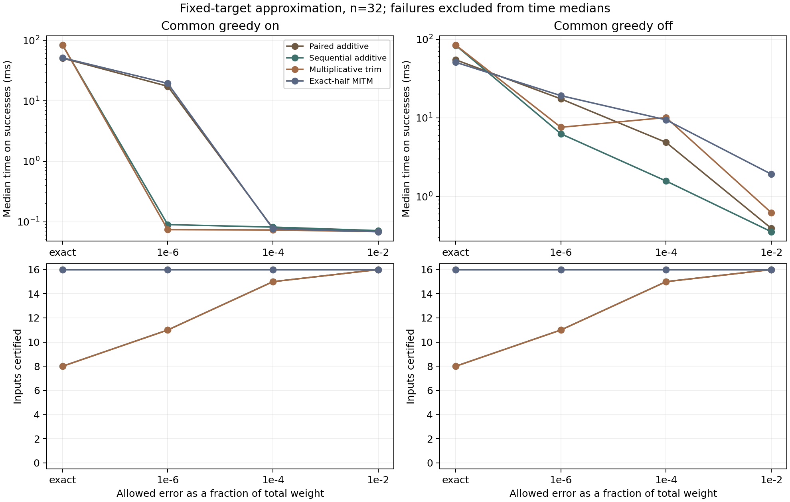

# Does pairing add value to certified approximation?

Series navigation: [reading order](../index.html#arc) · [Note IV: pairing in certified approximation](../notes/04-certified-approximation/Certified_Approximation_of_Subset_Sum.html).

**Central question:** "If we only need to get close to the target, and know how close, can our framework avoid much of the exponential search?"

This experiment supports [Note IV](../notes/04-certified-approximation/Certified_Approximation_of_Subset_Sum.html). Its added-value question is whether pairing error-bounded summaries improves on applying the same approximation rule sequentially. The [mathematical specification](APPROXIMATION_SPEC.md) supplies a common correctness contract using established approximation ideas.

## The controlled comparison

With common greedy disabled, n=32, and epsilon=1e-4, pairing is faster than sequential additive trimming on 7 of 15 jointly certified inputs. The median per-input sequential/paired time ratio is 0.993. Paired summaries certify 16 of 16 inputs within the per-summary state cap; sequential additive certifies 15. This is the comparison that isolates the organization of the summaries while holding the additive approximation rule fixed. The paper treats its negative timing finding and the resource-limit exception as the result, scoped to the tested setting. The full sweep below also retains regimes where pairing helps, including exact half-summary organization.

## Experimental contract

Find a subset on either side of a fixed target. Return its actual sum and deterministic bounds on the minimum absolute distance. A result is certified when upper minus lower is at most the absolute tolerance. Tolerance is floor(epsilon * sum(weights)); epsilon is 1e-2, 1e-4, 1e-6, or zero. The absolute tolerance may already be zero on small-weight inputs.

Four Python implementations retain original-item witnesses and use exact integer arithmetic: paired additive summaries, sequential additive summaries (the pairing ablation), a multiplicatively trimmed sequential list adapted to the full sum range, and exact-half meet-in-the-middle. The conventional multiplicative trimming baseline is adapted from [these lecture notes](https://courses.grainger.illinois.edu/cs473/fa2015/w/lec/slides/10_notes.pdf); it is not a benchmark of the fastest published approximation algorithms. All four can stop as soon as a witness lies within tolerance, since zero is always a lower bound.

There are 48 generated list-target instances across sizes [16, 24, 32], with seeds [0, 1]. Every method receives the same descending item order. The main comparison includes the same greedy witness search for all methods; the largest size also runs without it. The ablation still permits witness-based stopping during summary construction. Exact optima are computed separately and never supplied to a solver. All lists with at most 16 items are additionally checked by independent Gray-code enumeration.

Families reuse narrow, wide planted, mixed no-solution, modular no-solution, and the prior 41-bit unique/pair hard cases. Two added controls are superincreasing weights with a unique nearest subset (isolated, deliberately easy for descending greedy) and nearly equal billion-scale weights with many sums near the target (clustered). Raw weights, seeds, targets, optima, returned witnesses, bounds, merge counts, and method outcomes are all recorded.

A method may retain at most 65,536 representatives in one summary. Of 1024 method outcomes, 80 hit that cap. These return honest partial bounds and are counted as failures to reach the requested tolerance, not as fast successful answers. The cap is on an individual summary, not total memory; paired methods hold both halves.

Successful times are medians of 3 uninstrumented runs. State-limit outcomes are timed once. Peak Python-traced memory is measured in a separate run and is not process RSS. Input generation, oracle computation, verification, and plotting are excluded from solver timing. Execution order rotates across tolerances and seeds. Environment: Python 3.13.5, Windows-11-10.0.26200-SP0.

## Largest-size results (n=32)

Each cell is median milliseconds among certified outcomes, followed by certified/total counts. Different success counts mean the timing medians cover different subsets of inputs. The matched comparisons below avoid that ambiguity.

| Greedy | epsilon | Paired additive | Sequential additive | Multiplicative trim | Exact-half MITM |
|---|---|---:|---:|---:|---:|
| on | 1e-2 | 0.069 (16/16) | 0.071 (16/16) | 0.069 (16/16) | 0.069 (16/16) |
| on | 1e-4 | 0.078 (16/16) | 0.082 (15/16) | 0.073 (15/16) | 0.077 (16/16) |
| on | 1e-6 | 17.413 (16/16) | 0.090 (11/16) | 0.074 (11/16) | 19.469 (16/16) |
| on | exact | 50.821 (16/16) | 83.573 (8/16) | 83.921 (8/16) | 51.531 (16/16) |
| off | 1e-2 | 0.394 (16/16) | 0.357 (16/16) | 0.624 (16/16) | 1.925 (16/16) |
| off | 1e-4 | 4.880 (16/16) | 1.575 (15/16) | 10.102 (15/16) | 9.443 (16/16) |
| off | 1e-6 | 17.457 (16/16) | 6.273 (11/16) | 7.592 (11/16) | 19.179 (16/16) |
| off | exact | 54.790 (16/16) | 83.773 (8/16) | 84.515 (8/16) | 50.944 (16/16) |

## Matched comparisons

Ratios are per-input baseline time divided by paired time, then their median is taken. A ratio above one favors pairing. Only jointly certified inputs enter a ratio; failures remain visible in the table above. Tiny greedy-only times should not be read as stable algorithmic differences.

| Greedy | epsilon | Baseline | Paired faster / matched | Median baseline / paired |
|---|---|---|---:|---:|
| on | 1e-2 | Sequential additive | 10/16 | 1.011 |
| on | 1e-2 | Multiplicative trim | 6/16 | 0.986 |
| on | 1e-2 | Exact-half MITM | 9/16 | 1.003 |
| on | 1e-4 | Sequential additive | 7/15 | 1.000 |
| on | 1e-4 | Multiplicative trim | 10/15 | 1.040 |
| on | 1e-4 | Exact-half MITM | 9/16 | 1.005 |
| on | 1e-6 | Sequential additive | 10/11 | 1.046 |
| on | 1e-6 | Multiplicative trim | 6/11 | 1.042 |
| on | 1e-6 | Exact-half MITM | 11/16 | 1.021 |
| on | exact | Sequential additive | 7/8 | 3.290 |
| on | exact | Multiplicative trim | 8/8 | 3.343 |
| on | exact | Exact-half MITM | 11/16 | 1.006 |
| off | 1e-2 | Sequential additive | 3/16 | 0.963 |
| off | 1e-2 | Multiplicative trim | 12/16 | 1.307 |
| off | 1e-2 | Exact-half MITM | 10/16 | 1.759 |
| off | 1e-4 | Sequential additive | 7/15 | 0.993 |
| off | 1e-4 | Multiplicative trim | 12/15 | 1.129 |
| off | 1e-4 | Exact-half MITM | 14/16 | 1.140 |
| off | 1e-6 | Sequential additive | 5/11 | 0.995 |
| off | 1e-6 | Multiplicative trim | 11/11 | 1.195 |
| off | 1e-6 | Exact-half MITM | 11/16 | 1.012 |
| off | exact | Sequential additive | 6/8 | 3.256 |
| off | exact | Multiplicative trim | 7/8 | 3.285 |
| off | exact | Exact-half MITM | 7/16 | 0.996 |

## Family detail and memory

Largest size (n=32), epsilon=1e-4, common greedy off. Cells show separate medians over certified outcomes, with success counts. Memory is peak traced MiB; approximate merges exclude exact duplicate merging. A witness may meet tolerance before the method needs to merge any unequal sums.

| Family | Paired ms (count) | MITM ms (count) | Paired MiB | MITM MiB | Paired approximate merges |
|---|---:|---:|---:|---:|---:|
| narrow | 0.240 (2/2) | 0.242 (2/2) | 0.007 | 0.007 | 0.000 |
| wide | 31.069 (2/2) | 37.356 (2/2) | 2.756 | 3.836 | 3779.000 |
| mixed_no | 0.704 (2/2) | 9.443 (2/2) | 0.006 | 0.422 | 328.000 |
| modular_no | 21.098 (2/2) | 15.171 (2/2) | 1.040 | 1.040 | 0.000 |
| unique | 91.597 (2/2) | 173.586 (2/2) | 6.086 | 14.447 | 21635.500 |
| pairs | 29.102 (2/2) | 30.718 (2/2) | 1.808 | 1.895 | 541.000 |
| isolated | 0.238 (2/2) | 0.253 (2/2) | 0.013 | 0.013 | 0.000 |
| clustered | 0.273 (2/2) | 2.212 (2/2) | 0.006 | 0.049 | 106.500 |

## Observed outcomes

At epsilon=1e-2 on the largest inputs, the shared greedy search alone certifies 16 of 16 inputs before the methods diverge. These outcomes do not demonstrate a compression advantage.

With common greedy disabled and epsilon=1e-4, pairing is faster than exact-half MITM on 14 of 16 jointly certified largest-size inputs. The median per-input MITM/paired ratio is 1.140. Read this alongside the sequential-additive comparison and merge counts to distinguish the effects of grouping, approximation, and witness-based stopping.

At that same setting, pairing is faster than sequential additive trimming on 7 of 15 jointly certified inputs. This comparison does not establish a consistent additional timing benefit from pairing; the paired method certifies 16 of 16 inputs within the cap, while sequential additive certifies 15. At zero tolerance, paired additive and exact-half MITM construct the same exact summaries. The experiment supports a benefit from controlled approximation on some families, without establishing a new general advantage from pairing.



## Interpretation and limits

The main contribution is the controlled negative timing finding: the key approximation comparison identifies no consistent additional timing benefit from pairing over the same additive rule used sequentially, alongside its state-cap exception. Approximation can make coverage cheaper without pairing being responsible for the savings. The result limits the tested framework's demonstrated added value from pairing; it is not an impossibility result or a statistical finding of equivalence.

The additive invariant supplies deterministic correctness and a polynomial bound in n and inverse normalized tolerance when resources are unrestricted. This specializes established approximation ideas. Correct certification makes the accuracy contracts comparable; a separate runtime comparison establishes whether their organization adds a computational benefit.

The sequential additive control is essential: a win over multiplicative trimming alone could be caused by the error allocation rule rather than by pairing. A cheap common witness can also answer a loose-tolerance question before any compression occurs. Positive tolerances do not guarantee faster execution on every input. These are small synthetic families and two seeds, with deterministic accuracy guarantees and descriptive runtime summaries, not statistical confidence intervals.

## Reproduce

```powershell
python -m unittest discover -s subset-sum -p test_certified_approximation.py -v
python subset-sum/approximation_experiment.py
python build_papers.py
```

Use `--quick` for a separate smoke dataset, `--no-plots` to avoid a matplotlib dependency, or `--report-only` to regenerate the report and plots from the saved full dataset. Full measurements are in [approximation_results.json](approximation_results.json); aggregate comparisons are in [approximation_summary.json](approximation_summary.json).
