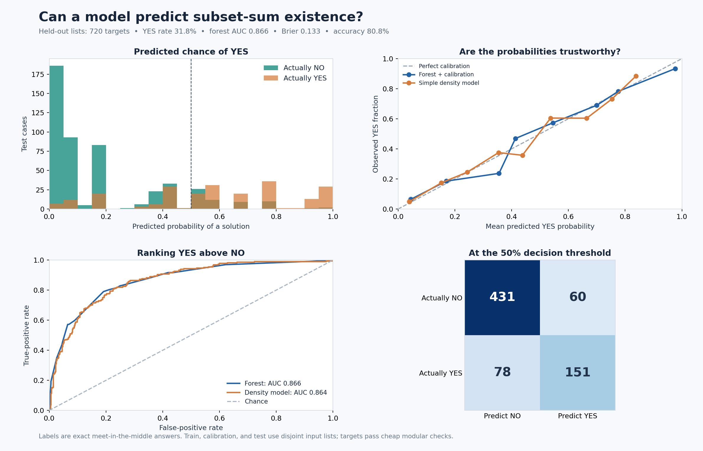
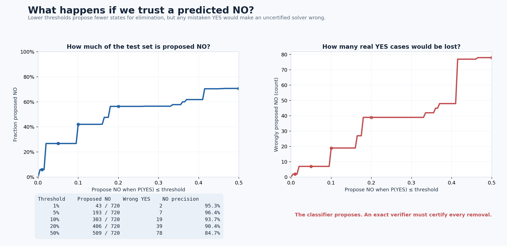
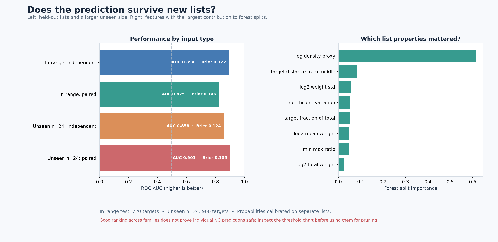

# Subset-sum probability classifier

Series navigation: [reading order](../index.html#arc) · [Note IV: pairing in certified approximation](../notes/04-certified-approximation/Certified_Approximation_of_Subset_Sum.html).

This experiment is discussed in [companion Note II](../notes/02-subset-sum-stress-test/Subset_Sum_as_a_Stress_Test.html) and reinterpreted for the random-target question in [Note III](../notes/03-probability-valued-subset-sum/Probability_Valued_Subset_Sum.html).

A random forest predicts the probability that a target can be formed from a list of positive integers. Every label is computed exactly by meet-in-the-middle. Targets are sampled independently of labels from the middle 40% of each list's total sum, then required to pass simple modular certificates. The model sees only summary features of the list and target, not the exact subset sums.

Here $n$ is the number of weights, and the predicted YES chance in the charts is the model's estimate, not a certificate. ROC AUC (area under the receiver operating characteristic curve) measures how well the score ranks YES above NO; 0.5 is chance ranking and 1 is perfect ranking. Brier score is the mean squared difference between predicted YES chances and exact 0/1 labels, so lower is better.
The chart's `log2` means base-2 logarithm, `std` means standard deviation, and coefficient of variation is standard deviation divided by mean weight. The log density proxy compares the number of possible count patterns with the spread of the weights; it is only a model feature, not a certificate. `independent` lists use separately sampled weights, while `paired` lists repeat each sampled value twice.

- Training: 3,360 targets; calibration: 720; held-out test: 720. Splits use disjoint input lists.
- Held-out YES rate: 31.8%. Forest AUC 0.866, Brier 0.133, accuracy 80.8%.
- Simple density-model AUC 0.864, Brier 0.136. On unseen n=24 lists, forest AUC 0.879, Brier 0.115.
- Even at a predicted YES chance of at most 1%, 2 of 43 proposed NO answers are actually YES.

## Charts

## Interpretation

The classifier can rank cases by likelihood, but a predicted NO is not a proof. False NO predictions are exactly the dangerous errors for certified elimination. The threshold chart counts them explicitly; the framework still needs an exact verifier.

The forest performs about as well as the simple density-based classifier. This suggests most of its signal comes from density, rather than a new property of the pairing framework. The comparison is not against an optimized learned solver. The input families are synthetic, the probability calibration is specific to their sampling distribution, and the model has not been shown to reduce exact solution time.

Reproduce with `python subset-sum/ml_experiment.py` after installing [requirements-ml.txt](requirements-ml.txt). Raw scores and thresholds are in [ml_results.json](ml_results.json); each held-out prediction is in [ml_predictions.csv](ml_predictions.csv).
