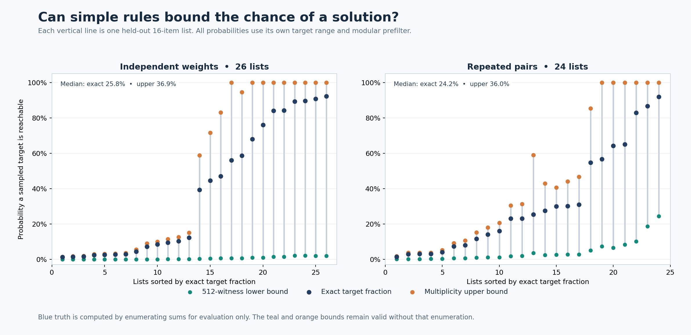
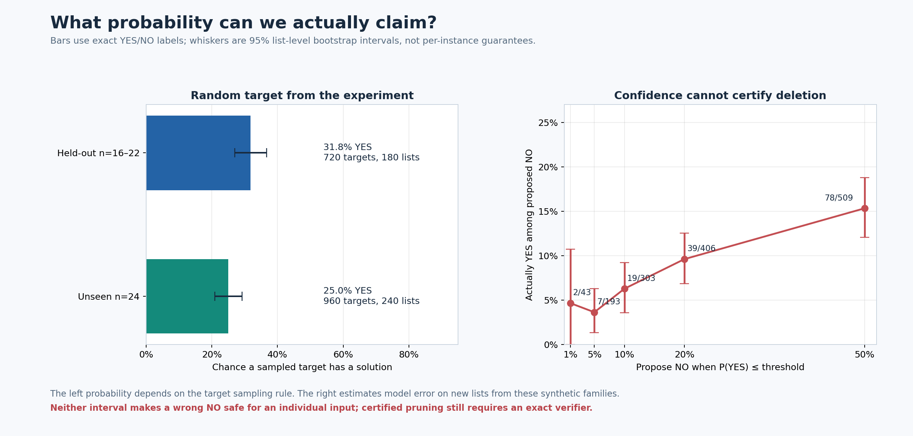

# Probability-valued subset sum: a precise extension

This technical record supplies the derivations, chart, and per-list measurements behind [companion Note III](../Probability_Valued_Subset_Sum.html).

For fixed positive weights $w=(w_1,\ldots,w_n)$ and target $t$, the existence answer
$Y(w,t)=\mathbf{1}\{t=\sum_i x_iw_i\text{ for some }x_i\in\{0,1\}\}$ is still exactly 0 or 1.
To make the **outcome** a probability, specify a distribution $\mu$ for a random target $T$ on a finite set $D$:

$$
A(w)=\left\{\sum_i x_iw_i:x_i\in\{0,1\}\right\},
\qquad q_\mu(w)=\Pr_{T\sim\mu}[T\in A(w)]=\sum_{t\in A(w)\cap D}\mu(t).
$$

For uniform $T$ on $D$, $q_\mu(w)=|A(w)\cap D|/|D|$: the fraction of possible targets that have a solution.
For a nonuniform target distribution, count probability mass instead of targets.
This is a new, well-defined quantity; it does not make a particular target's YES/NO answer uncertain.

## Certified bounds

Let $L\subseteq A(w)\cap D$ contain *distinct witnessed sums*. Let $R_m(w)$ be the set of residues modulo $m$ reachable by subsets, and set

$$
U=D\cap\bigcap_{m\in M}\{t:t\bmod m\in R_m(w)\},
\qquad \mu(L)\le q_\mu(w)\le\mu(U).
$$

The lower bound is exact because every witnessed sum is reachable. The upper bound is exact because every reachable sum passes every residue test.
More exact summaries can enlarge $L$; more sound certificates can shrink $U$.
When pairing partial-sum summaries, count the *distinct union* of pair sums; multiplying counts would double-count collisions.
With uniform $D$, these bounds are $|L|/|D|$ and $|U|/|D|$.
A second upper bound is $q_\mu(w)\le\min(1,\prod_j(c_j+1)/|D|)$ for uniform $D$,
where $c_j$ are multiplicities of the distinct weight values: each value can be selected in only $c_j+1$ ways.
Use the minimum of this and the residue bound. Computing a tight bound has a cost; a loose bound alone does not speed up search.

For a requested tolerance $\varepsilon$, the interval $[\mu(L),\mu(U)]$ certifies an additive-$\varepsilon$ answer once $\mu(U)-\mu(L)\le\varepsilon$.
For **exact** $q_\mu$, the gap must close to zero. As in the original coverage model, the work of finding witnesses and certificates must be counted.

### A check on held-out 16-item lists

For the 50 held-out $n=16$ lists, we reconstructed each list and its target sampling rule, then enumerated attainable sums **only to assess the bounds**.
The lower bound uses 512 randomly chosen subsets as witnesses; the upper bound uses only value multiplicities and the number of eligible targets.
Across lists, the median certified interval endpoints were 0.8% and 36.0%, while the median exact target fraction was 24.2%.
The upper bound can be useful when attainable sums are sparse relative to eligible targets; the witness lower bound remains loose with this small budget.
These medians summarize different lists, so they are not themselves a single certified interval.

## What the classifier estimates

The trained model outputs $\widehat p(w,t)$. With the full instance fixed, the true conditional existence probability is $Y(w,t)\in\{0,1\}$.
The useful statistical interpretation is $\Pr(Y=1\mid\phi(w,t))$ under the synthetic input distribution, where $\phi$ is the model's lossy feature vector.
Calibration can make this reliable *on average* for that distribution; it is not a deterministic bound for one target.
It can prioritize which targets or regions deserve exact checking, or help stratify estimates of $q_\mu$.

If $m$ targets are drawn independently from $\mu$ for one fixed list and labeled exactly, the sample YES rate $\widehat q$ obeys

$$
\Pr(|\widehat q-q_\mu(w)|>\varepsilon)\le 2e^{-2m\varepsilon^2}.
$$

This is a sampling guarantee, not a fast subset-sum algorithm: exact labels may still be expensive.

## Existing held-out evidence, now interpreted probabilistically

The existing experiment draws four targets per independent list, conditionally on passing simple modular checks.
Its YES frequency therefore estimates success under **that target rule**, averaged over the generated lists; it is not $q_\mu(w)$ for any one list.
Because this rule already rejects targets excluded by the tested moduli, those same residue screens give a vacuous upper bound for its conditional target distribution.
On 180 held-out lists (720 targets), the observed YES rate was 31.8%; a 95% list-level bootstrap interval is [26.9%, 36.7%].
Treating each list's four-target average as one independent bounded observation, Hoeffding gives a wider distribution-free 95% interval [21.7%, 41.9%] for the mean success rate across the test schedule.
For 240 unseen $n=24$ lists (960 targets), the rate was 25.0%; the analogous interval is [20.9%, 29.2%].

Among the 43 held-out targets given $\widehat p\le 1\%$, 2 actually had a solution: an observed missed-YES rate of 4.7%, with a 95% list-level bootstrap interval [0.0%, 10.7%].
These bootstrap intervals describe sampling uncertainty across lists. They are **not sound per-instance bounds** and cannot certify pruning.
In particular, a bootstrap interval may be $[0,0]$ when a sample contains zero errors; that does not establish zero future error risk.

**Promising direction:** build cheap, instance-specific $L$ and $U$ that close quickly for useful target distributions; use the classifier to choose where exact effort is spent.
Then compare total bound-building cost and interval width against direct exact methods.
The present experiment establishes a statistical signal, not a new exact subset-sum algorithm.

Reproduce the empirical intervals and chart with `python subset-sum/probability_extension.py` after running `ml_experiment.py`.
